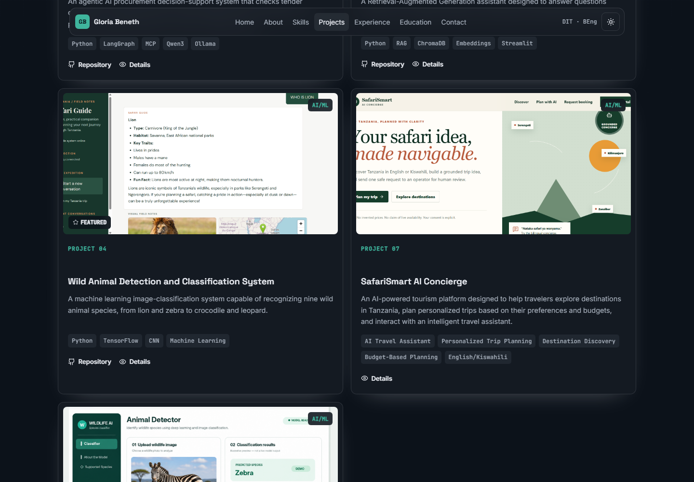
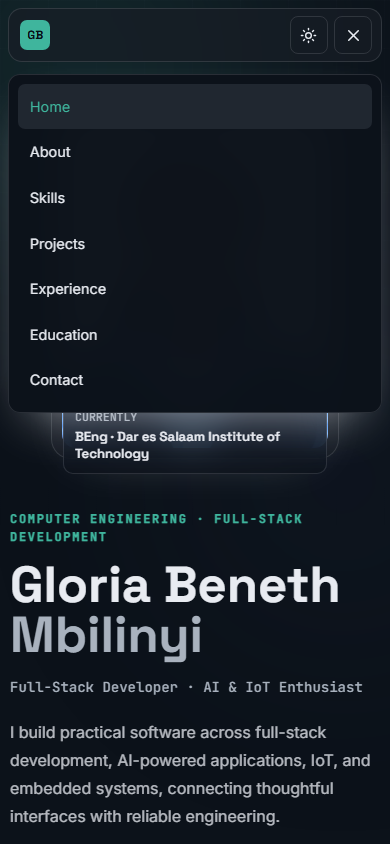

# Gloria Developer Portfolio

A responsive developer portfolio for **Gloria Beneth Mbilinyi**, a Computer Engineering student and full-stack developer interested in artificial intelligence, machine learning, IoT, embedded systems, and practical software engineering.

This portfolio was upgraded for **Datheon Full Stack Web Development Internship - Task 1: Personal Developer Portfolio & Project Showcase**. It presents Gloria's verified technical work, education, skills, contact information, and downloadable CV in an accessible single-page experience.

**Live portfolio:** [gloria-mbilinyi-gloria-portfolio.gloria-portfolio-tz.workers.dev](https://gloria-mbilinyi-gloria-portfolio.gloria-portfolio-tz.workers.dev)

## Project Overview

The site is designed for internship reviewers, recruiters, collaborators, and other developers. It combines a concise personal introduction with project filtering, detailed project summaries, responsive navigation, theme controls, and clear contact actions.

The project preserves Gloria's original photographs and portfolio information while improving presentation, accessibility, maintainability, and production readiness.

## Key Features

- Professional hero and About sections
- Categorized technical skills
- Filterable project showcase with repository links
- Project detail dialogs
- Education and practical experience timelines
- Downloadable CV
- Verified GitHub, LinkedIn, and email contact links
- Responsive desktop, tablet, and mobile layouts
- Mobile hamburger navigation
- Persistent light and dark themes
- Smooth in-page navigation
- Reduced-motion support
- SEO and social-sharing metadata
- Accessible navigation, forms, dialogs, and controls

## Technology Stack

| Area          | Technologies                              |
| ------------- | ----------------------------------------- |
| Framework     | React 19, TanStack Start, TanStack Router |
| Language      | TypeScript                                |
| Styling       | Tailwind CSS 4, custom CSS design tokens  |
| Animation     | Motion for React                          |
| Forms         | React Hook Form, Zod                      |
| Icons         | Lucide React                              |
| Build tooling | Vite 8, Nitro                             |
| Quality       | ESLint, Prettier, TypeScript              |

## Project Architecture

```text
gloria-portfolio-src/
|-- .github/workflows/      # Continuous integration checks
|-- docs/screenshots/       # Verified desktop and mobile QA captures
|-- public/                  # Public files, CV, robots.txt, favicon
|-- scripts/                 # CV generation and automated QA scripts
|-- src/
|   |-- assets/images/      # Profile, training, and project images
|   |-- components/         # Portfolio sections and reusable UI
|   |-- data/portfolio.ts   # Portfolio content and project records
|   |-- lib/                # Shared utilities
|   |-- routes/             # TanStack file-based routes and metadata
|   |-- router.tsx          # Router configuration
|   |-- server.ts           # Server entry and SSR error handling
|   |-- start.ts            # TanStack Start middleware
|   `-- styles.css          # Theme tokens and responsive design
|-- package.json            # Scripts and dependencies
|-- tsconfig.json           # Strict TypeScript configuration
`-- vite.config.ts          # Vite and TanStack Start configuration
```

Portfolio content is centralized in `src/data/portfolio.ts`, while `src/components/Portfolio.tsx` composes the visitor experience. TanStack Start provides routing and server rendering, and the shared stylesheet defines the light/dark design system and responsive breakpoints.

## Installation and Local Development

### Prerequisites

- Node.js 20 or newer
- npm 10 or newer
- Git

### Setup

```bash
git clone https://github.com/gloria-mbilinyi/gloria-portfolio.git
cd gloria-portfolio
npm install
npm run dev
```

Open the local URL printed by Vite, normally `http://localhost:3000`.

### Available Commands

```bash
npm run dev         # Start the development server
npm run typecheck   # Check TypeScript without emitting files
npm run lint        # Run ESLint
npm run format:check # Verify formatting without changing files
npm run test        # Run portfolio functionality checks
npm run check       # Run the complete source-quality suite
npm run qa:browser  # Test the running site at http://127.0.0.1:4180
npm run build       # Create a production build
npm run preview     # Preview the production build locally
npm run format      # Format supported project files
```

## Featured Projects

The portfolio currently presents nine projects, in the same order as `src/data/portfolio.ts`:

1. **TenderGuard Africa** (`AI/ML`) - Agentic AI procurement decision support for tender-compliance checks, bid-price comparison, supplier-data review, and auditable committee evidence.
   - **Technologies:** Python, LangGraph, MCP, Qwen3, Ollama, Pydantic · [Repository](https://github.com/gloria-mbilinyi/TenderGuard-Africa)
2. **Smart Clinic Management System** (`Software`) - Full-stack healthcare management for administrator, doctor, and patient roles, appointments, authentication, and medical records.
   - **Technologies:** Java, Spring Boot, Spring Security, JWT, PostgreSQL, React, Vite · [Backend](https://github.com/gloria-mbilinyi/smart-clinic) · [Frontend](https://github.com/gloria-mbilinyi/smart-clinic-frontend)
3. **DIT Smart Assistant** (`AI/ML`) - Retrieval-Augmented Generation assistant for questions related to Dar es Salaam Institute of Technology.
   - **Technologies:** Python, RAG, ChromaDB, embeddings, Streamlit · [Repository](https://github.com/gloria-mbilinyi/dit-smart-assistant)
4. **Wild Animal Detection and Classification System** (`AI/ML`) - Machine-learning image classifier for nine wild animal species.
   - **Technologies:** Python, TensorFlow, CNN, machine learning · [Repository](https://github.com/gloria-mbilinyi/Wildlife-Safari-Assistant)
5. **LiftSystem - Accessible Elevator Control** (`Embedded Systems`) - Arduino elevator prototype with floor controls, LCD feedback, sensing, emergency controls, buzzer, and audio notifications.
   - **Technologies:** Arduino, Embedded C/C++, servo, ultrasonic sensor, LCD · [Repository](https://github.com/gloria-mbilinyi/liftSystem)
6. **Smart Water Tank Level Monitoring** (`IoT`) - Water-level and environmental monitoring with ultrasonic, water-level, and temperature sensors.
   - **Technologies:** Arduino, HC-SR04, DHT11, LCD, sensors · Repository not publicly listed
7. **SafariSmart AI Concierge** (`AI/ML`) - AI-powered tourism platform for exploring Tanzanian destinations, planning personalized budget-aware trips, and interacting with a bilingual travel assistant.
   - **Capabilities:** AI travel assistant, personalized trip planning, destination discovery, budget-based planning, English/Kiswahili support, booking requests, operator portal · [Repository](https://github.com/gloria-mbilinyi/safarismart-ai-concierge)
8. **Gee Player** (`Mobile`) - Flutter media player for video and music playback with English and Kiswahili subtitle support.
   - **Technologies:** Flutter, Dart, media_kit, Dio, SQLite · [Repository](https://github.com/gloria-mbilinyi/GeePlayer)
9. **Animal Detector** (`AI/ML`) - TensorFlow image-classification application packaged through Streamlit.
   - **Technologies:** Python, TensorFlow, CNN, Streamlit · [Repository](https://github.com/gloria-mbilinyi/animal_detector)

## Responsive Design

The layout is mobile-first and adapts across compact phones, tablets, laptops, and wide desktop screens. Navigation collapses into a keyboard-accessible mobile menu, project and skill grids reflow at smaller widths, and typography uses fluid sizing where appropriate.

## Testing and Quality Assurance

Before release, run the source checks and production build:

```bash
npm run typecheck
npm run lint
npm run test
npm run build
```

For repeatable browser QA, start the development server on the test port in one terminal and run the browser suite in another:

```bash
npm run dev -- --host 127.0.0.1 --port 4180 --strictPort
npm run qa:browser
```

The browser suite launches isolated headless Chrome sessions at 1440 x 1000 and 390 x 844. It verifies viewport overflow, theme switching, mobile navigation, project filtering, the SafariSmart detail dialog and screenshot, CV availability, contact links, metadata, and browser-console errors.

Manual QA covers:

- Navigation and active-section behavior
- Mobile menu operation
- Light/dark theme persistence
- Project filtering and dialogs
- CV download
- Contact links and form behavior
- Keyboard navigation and reduced motion
- Desktop and mobile responsive layouts

## Screenshots

These genuine browser-QA captures are generated from the local portfolio at the tested desktop and mobile viewports.

| Desktop project showcase                                                                      | Mobile navigation                                                                   |
| --------------------------------------------------------------------------------------------- | ----------------------------------------------------------------------------------- |
|  |  |

## Live Demo

The portfolio is publicly available on Cloudflare Workers:

[View the live Gloria Developer Portfolio](https://gloria-mbilinyi-gloria-portfolio.gloria-portfolio-tz.workers.dev)

The production deployment has been verified at desktop and mobile viewports, including the homepage, all nine project images, responsive navigation, and downloadable CV.

## GitHub Repository

[github.com/gloria-mbilinyi/gloria-portfolio](https://github.com/gloria-mbilinyi/gloria-portfolio)

## Developer Information

**Gloria Beneth Mbilinyi**

Computer Engineering Student | Full-Stack Developer | AI & Machine Learning Enthusiast

- GitHub: [github.com/gloria-mbilinyi](https://github.com/gloria-mbilinyi)
- LinkedIn: [linkedin.com/in/gloria-mbilinyi](https://www.linkedin.com/in/gloria-mbilinyi/)
- Email: [gloriambilinyi5@gmail.com](mailto:gloriambilinyi5@gmail.com)

## Datheon Internship Assignment

- **Program:** Datheon Full Stack Web Development Internship
- **Assignment:** Task 1 - Personal Developer Portfolio & Project Showcase
- **Objective:** Deliver a professional, responsive portfolio that clearly presents the developer, technical skills, projects, source repositories, CV, and contact information.

### Task 1 requirements addressed

- Professional hero and About sections
- Technical-skills presentation
- Nine current project cards with descriptions and verified repository links where available
- Downloadable CV and working GitHub, LinkedIn, and email links
- Responsive desktop, tablet, and mobile layouts with hamburger navigation
- Persistent dark/light theme, smooth scrolling, accessible controls, and reduced-motion support

### Completed deliverables

- Responsive React and TypeScript portfolio preserving the original personal content and photographs
- Filterable project showcase with accessible detail dialogs and genuine project screenshots
- SEO and social metadata, semantic navigation, keyboard support, and theme persistence
- Automated TypeScript, ESLint, formatting, content, browser, production-build, and GitHub Actions checks
- Project-specific documentation with local setup, architecture, testing, screenshots, repository links, and a verified Cloudflare Workers live demo

## License

This repository contains Gloria's personal portfolio content and photographs. Please request permission before reusing personal assets or biographical content.
